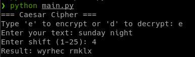
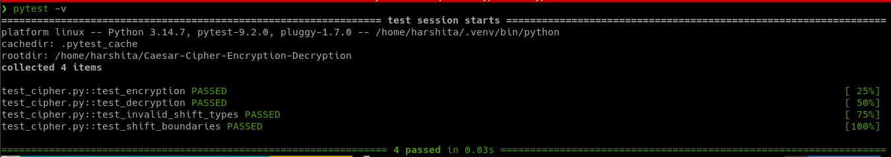

# Caesar Cipher – Encryption & Decryption

A command-line Caesar Cipher application built using Python. It supports text encryption and decryption through character shifting, with input validation and automated unit testing using pytest.

## Features

- Encrypts and decrypts text using character shifting.
- Preserves uppercase and lowercase characters.
- Maintains spaces, numbers, and punctuation.
- Validates shift values between 1 and 25.
- Rejects invalid data types, including booleans and floats.
- Includes automated unit tests using pytest.

## Project Structure

```text
Caesar-Cipher-Encryption-Decryption/
│
├── images/
│   ├── image1.png
│   └── image2.png
│
├── main.py
├── test_cipher.py
├── README.md
├── LICENSE
```

## Requirements

- Python 3.x
- pytest

## Installation

Clone the repository:

```bash
git clone https://github.com/HarshitaNegi82/Caesar-Cipher-Encryption-Decryption.git
```

Navigate to the project directory:

```bash
cd Caesar-Cipher-Encryption-Decryption
```

Install pytest:

```bash
python -m pip install pytest
```

## Usage

Run the application:

```bash
python main.py
```

Choose an operation:

- Enter `e` to encrypt.
- Enter `d` to decrypt.

Enter your text and a shift value between 1 and 25.

### Example Output

```text
=== Caesar Cipher ===
Type 'e' to encrypt or 'd' to decrypt: e
Enter your text: hello
Enter shift (1-25): 3
Result: khoor
```



## Automated Testing with pytest

Run the test suite:

```bash
pytest -v
```

### Test Coverage

| Test Function | Description |
|---|---|
| `test_encryption` | Verifies standard encryption. |
| `test_decryption` | Checks decryption with multiple words and punctuation. |
| `test_invalid_shift_types` | Rejects booleans, strings, and floats. |
| `test_shift_boundaries` | Validates allowed and out-of-range shift values. |

### Test Results

All four test functions passed successfully in the local test run.



